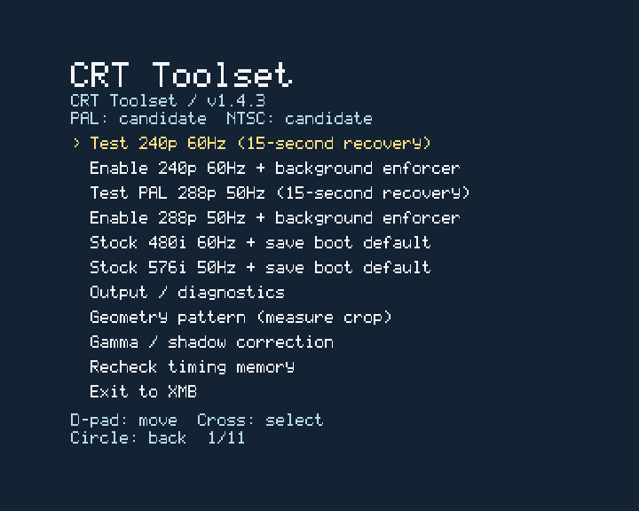

# CRT Toolset (ps3-240p)

240p/288p output and native analog gamma correction for PS3 AV Multi Out,
verified on Evilnat 4.93 CEX + Cobra. Current release: **v1.4.3**
(package version **01.43**).

**CLAIMED (owner):** gamma works together with both 240p and 288p on the tested
CRT setup. [Release notes](docs/RELEASE_v1.4.3.md) and
[gamma evidence and instructions](docs/GAMMA.md).

<!-- progress:start -->
## Progress


**Overall: about 79%** (effort-weighted estimate; the real risk is not evenly spread).

| Stage | Weight | Done |
|---|---:|---|
| Static analysis & claim verification (hypercalls, netemu, RSX attr 0x100) | 15% | `██████████` 100% |
| AV-manager timing tables & emulator video path trace | 20% | `██████████` 100% |
| LV1 process loader & memory architecture modeling | 15% | `██████████` 100% |
| Live LV1 anchor resolution (sysmgr_ss physical segments) | 15% | `██████████` 100% |
| Encoder & RSX 15 kHz progressive scanline feasibility | 15% | `████░░░░░░` 40.0% |
| Prototype LV1 timing patch / profile override | 10% | `████░░░░░░` 35.0% |
| Native PS3 homebrew application (EBOOT.BIN / PS3-240P.pkg) | 10% | `████████░░` 80.0% |
| Hardware waveform verification (line count, sync, 15.7 kHz) | 5% | `░░░░░░░░░░` 0% |

_Last update: 2026-11-13. v1.4.3 published with native gamma and calibration guidance. New offline 540p60 investigation identifies OSSC Pro timing precedent, 4.93 1080i profile/clock/encoder paths, integer-line refresh choices and a component-HD-CRT validation plan. Added reproducible timing calculator; PS3 540p output remains unimplemented and unverified. No console access or output changes during this research._
<!-- progress:end -->

The progress block is generated from `docs/progress.json`; percentages estimate work, not electrical verification.

## v1.4.3: native analog gamma

**PROVEN (release source):** enter a correction value from **0.50 to 4.00**,
compare grayscale/shadow ramps, and test the native analog curve with automatic
recovery. **1.00 is neutral; higher values brighten shadows.** The dedicated
2.20 preset has been removed; use the value editor. Saving remembers the editor
value and does not apply gamma at boot.

Choose **Test system gamma**, then Cross during the countdown to keep it or
Circle to restore the previous curve. The helper's 15-second timer continues
while the PS menu is open. **Restore system gamma** restores the original
session baseline. [Full instructions](docs/GAMMA.md).

For calibration, set the TV's **Contrast/Picture**, adjust **Brightness** so
black is dark while near-black detail remains visible, then choose gamma.
Recheck black level and gamma after changing the TV controls.
[CRT calibration guide and research](docs/CRT_CALIBRATION.md).

**CLAIMED (owner, 2026-11-13):** gamma works "perfect so far" and alongside
both 240p and 288p. **UNKNOWN:** measured gamma response and broad game/model
coverage. The release keeps the tested helper unchanged and adds host-checked
preference replacement for repeated saves. [Validation and limits](docs/RELEASE_v1.4.3.md).

**PROVEN (implementation):** optional RetroArch Cg export writes a separate
content shader without editing existing configuration. Its execution in
RetroArch is untested. Use it as an alternative to native correction, rather
than applying both. [PC gamma preview](deliverables/CRT-Toolset-gamma-preview.png).

## v1.3.6: PAL and SD mode selection

**PROVEN (source and host checks):** this release adds a full-source
PAL 288p candidate, a background preference for either SD family, and explicit
stock **480i / 60 Hz** and **576i / 50 Hz** choices with picture confirmation
and a saved boot default. **CLAIMED (owner):** the corrected 288p test works
with a complete picture. **PROVEN (readback):** the analog head uses the
576-source / 624-frame candidate. Both stock modes and saved defaults were
verified live without reboot; the 288p helper starts and retains the picture
at XMB. See [the PAL checkpoint](docs/PAL_288P_DEVELOPMENT.md) for test limits.

**CLAIMED (owner, dev4):** the old dimming/spinner residue after the PS menu
now clears automatically. See [the repaint fix](docs/PS_MENU_REDRAW.md).

The menu groups each mode as **Test**, then **Enable enforcement**:
240p first, followed by 288p. Stock 480i/576i choices come next.

The [enforcer checkpoint](docs/ENFORCER_STATUS_2026-11-13.md) corrects earlier
helper claims: starting a thread did not prove mode enforcement. Dev6 fixes
resident-slot reuse and replaces incorrect raw syscalls with native VSH
display calls. Timed switching and a real XMB fallback correction from mode 4
back to mode 5 both passed, with 576/624 analog readback.

The recovered Gemini procedure and live-switch/reboot distinction are documented
in [SD mode switching](docs/SD_MODE_SWITCHING.md). The current low-line patch
requires CFW LV1 access; ordinary HEN is unsupported. See
[HEN compatibility and upstream evidence](docs/HEN_SUPPORT.md).

**PROVEN (package metadata):** the app is renamed **CRT Toolset**.
Its existing title ID is retained so installing the update replaces the old app.

**CLAIMED (owner):** the requested PAL PS1 game/PS-menu/return-XMB test flow
works; the title was not specified. Electrical field parity, extended stability
and broad game/core coverage remain unmeasured or untested. PAL RetroArch
settings have not yet been validated. [Release notes](docs/RELEASE_v1.3.6.md).

## Menu preview



Rendered locally with the production C renderer and menu strings. No PS3 is
needed: run `python -B tools/render_menu.py` (host compiler and Pillow required).

## v1.2.2: full-frame Mode 4

**CLAIMED (owner hardware tests, 2026-11-13):** the app and XMB show a complete picture, PS1 games work with `ps1_emu.self`, and RetroArch 1.10.0 runs Super Mario All-Stars with a working PS menu after its saved resolution/viewport are corrected to 720x480. See [the evidence and geometry checkpoint](docs/GEOMETRY_STATUS_2026-11-13.md).

**PROVEN (code and captured register readback):** the Mode-4 recipe retains full 480-line source fetching, uses a 522-line frame, and keeps unity scaling. The previous scaler experiment is disabled in normal enable. Source: `app/source/timing_payloads.h`, `app/source/main.c`, and the checkpoint's private capture references.

**UNKNOWN at the v1.2.2 checkpoint:** electrical progressive-sync/field parity, broader game/core compatibility, and PAL geometry. The PAL geometry result is superseded by v1.3.6 above; electrical field parity remains unmeasured.

## Install and use

1. Exit CRT Toolset and install **CRT-Toolset.pkg** from [GitHub Releases](https://github.com/Gabarsolon/ps3-240p/releases/latest) through normal XMB Package Manager. Reboot after upgrading to clear old resident helpers/RAM edits, then open **CRT Toolset** (`PS240P001`).
2. Select AV Multi Out and start from a supported SD mode.
3. Test the desired 240p/288p mode, then choose its **Enable enforcement** option, confirm the picture, and return to XMB. Tests restore automatically after 15 seconds unless confirmed.
4. Stock 480i/576i choices stop correction and save the selected default after picture confirmation.
5. For gamma, open **Gamma / shadow correction**, edit the value, then choose **Test system gamma** and confirm during the countdown. [Instructions](docs/GAMMA.md).
6. For **240p / NTSC RetroArch**, apply the [SD settings](docs/RETROARCH_SD.md). The included fragment is for the tested 720x480 setup, not a validated PAL preset. The PKG does not edit RetroArch's config.

**PROVEN (implementation):** core timing/enforcement uses CFW LV1 access,
Cobra/PS3MAPI and native VSH interfaces. Saving boot defaults currently also
requires webMAN's named-key HTTP interface. Ordinary HEN is unsupported.

**PROVEN (development observation):** remote webMAN installation intermittently
froze this console; use normal XMB Package Manager. The v1.4.3 helper is byte-identical
to the owner-tested gamma development build. The final app changes are release
version text and the preference-save replacement fix; final checks were offline.

**PROVEN (implementation):** timing edits and the resident helper are runtime-only; reboot clears them. Enable again after reboot. The development helper checks slots, reuses an unchanged resident copy, and deploys by content. **Correction to v1.2.2's helper claim:** its raw polling calls were incorrect; automatic SD correction is established only for the native-interface fix documented in [the enforcer checkpoint](docs/ENFORCER_STATUS_2026-11-13.md). Sources: `plugin/vsh_240p.c`, `app/source/main.c`.

Diagnostic logs, overwritten when their respective app/helper starts:

- `/dev_hdd0/tmp/ps3_240p.log`
- `/dev_hdd0/tmp/vsh_240p.log`

## Build and validation

PS3DK 0.26.0, CMake, Ninja and Python are used for the app build. Host checks require clang or gcc.

```powershell
python -B tools/test_app.py
python -B tools/build_ps3_app.py
```

Optional comparison with a private 4.93 module:

```powershell
python -B tools/test_app.py --firmware <path-to-local-4.93-sysmgr_ss.elf>
```

**PROVEN (release checks):** gamma math/storage/IPC/recovery/native guards and timing/rollback/settings/lifecycle/native-video/UI tests, 21 startup/menu/overlay scenarios, the compiled helper audit, and all 54 stock timing/code target comparisons pass. The package validator checks the finalized container and its five members. These are offline checks, not electrical measurements. Source: `tools/test_app.py`, `tools/pkg_inspect.py`, `deliverables/package_manifest.json`.

The app builder packages the tracked `plugin/vsh_240p.sprx`. Rebuilding the helper with `tools/build_plugin.py` additionally requires the sibling native-PRX linker/packer/signing tools described in that script. The UI renderer reuses Buzz Bridge code; its attribution/license is in `app/BuzzBridge-LICENSE` and in the PKG.

## Research and history

- [540p60 for HD CRTs: source evidence, PS3 timing profiles and remaining work](docs/HD_CRT_540P.md). **UNKNOWN:** working PS3 output; research only, not an app feature.
- [Current geometry evidence and test results](docs/GEOMETRY_STATUS_2026-11-13.md).
- [Earlier app review and failed experiments](docs/APP_REVIEW_2026-11-11.md).
- [Verified research](docs/RESEARCH.md), [AV-manager trace](docs/LV1_AV_TRACE.md), [PS1/PS2 video paths](docs/BC_PS1_EMULATOR_VIDEO.md), and [live page resolution](docs/LV1_SYSMGR_SS_LOADADDR.md).
- Historical [feasibility assessment](docs/FEASIBILITY_240P_RSX_ENCODER.md) and [prototype specification](docs/PROTOTYPE_LV1_TIMING_PATCH.md) contain correction notices. [Waveform verification protocol](docs/VERIFICATION_WAVEFORM.md).

Sony-derived firmware, decrypted modules, decompiler output, phone photos and console captures remain in gitignored `local_only/`. This project does not implement firmware flashing.
