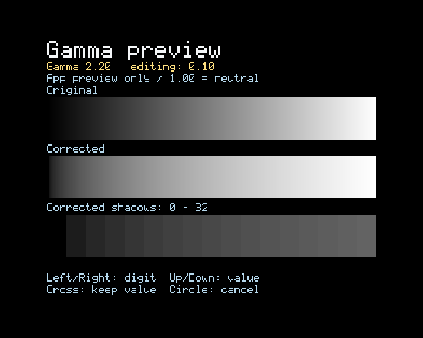

# Gamma integration (development)

**PROVEN (implementation):** CRT Toolset v1.4.3 includes a gamma value
editor, calibration ramps, saved preferences, an experimental native analog
gamma test, and independent RetroArch Cg export. This integrates the research
question from [ps3-gamma](https://github.com/Gabarsolon/ps3-gamma); that repository
contained research, not a working application. Source: `app/source/gamma.c`,
`app/source/main.c`, `plugin/vsh_gamma.c`, `plugin/gamma_service.c`.

## Use

Set the TV controls before choosing gamma, and recheck after changing contrast.
See [CRT calibration: black level, contrast and gamma](CRT_CALIBRATION.md).

**PROVEN (UI/source):** Open **Gamma / shadow correction**. Select **Enter gamma
value**. Left/Right selects the units, tenths or hundredths; Up/Down changes
that digit's place value. Cross keeps the edited number; Circle cancels it.
Range: 0.50-4.00. Enter a value such as 2.20 with the digit editor.

**PROVEN (math/source):** 1.00 is neutral. The curve is
`output = input ^ (1 / correction)`, so values greater than 1 brighten
shadows. At 2.20, 8-bit middle gray 128 becomes approximately 186. This is a
correction factor, not a claim that the CRT's measured display gamma is 2.20.
**UNKNOWN:** the exact setting/formula used by the owner's former Batocera
setup; the numerical setting alone does not establish an identical result.

**PROVEN (UI/source):** The editor compares an unchanged ramp, corrected ramp,
and corrected near-black steps. Its software correction affects this preview
only. Text remains uncorrected for readability. Saving remembers the selected
number; it does not enable gamma at boot or change the current display.
If native correction is already active, the preview labels its lower ramps
as additional correction rather than presenting the upper ramp as neutral.

**PROVEN (native test/source):** **Test system gamma** asks the VSH helper to
save the analog head's current three exponents and apply the selected value.
The helper restores after 15 seconds unless Cross confirms it; the app uses
a shorter 12-second confirmation window to allow for communication. Circle
restores immediately. The timer runs outside the foreground app, and failed
restoration retains the snapshot and retries. **Restore system gamma** undoes
a kept session curve back to the original session baseline. Cancelling a new
trial preserves a correction already kept earlier in the session. Reboot
clears the volatile setting.

**PROVEN (implementation limits):** This first native version supports only
the audited VSH signature and an enabled analog head with 720x480/576 RGB8
format 7. It refuses HD, other formats, invalid mappings, and invalid curve
values. It does not periodically force a kept curve back after another app
changes it. Restoration while outside the supported SD path may need to wait
until supported output returns. Sources: `plugin/vsh_gamma.c`,
`plugin/gamma_service.c`.

**CLAIMED (owner, release checkpoint):** gamma works well so far and together
with both 240p and 288p. **UNKNOWN:** measured transfer response, broad
PS1/RetroArch/native-game coverage and persistence through every video-mode
transition. API/cache success is not optical measurement.
Avoid combining native correction with a gamma shader: that would apply the
correction twice. A power curve preserves exact black and cannot reconstruct
pixel values already clipped to zero; see `crt_gamma_ramp` and generated Cg.

## What changed in the research

**PROVEN (private 4.93 CEX VSH analysis):** The actual native path is
`avset_setvideolut`, internal wrapper VA **0x5d8534**, through manager method
**0x5de124**. The serializer at **0x5e6210** sends AV command **0x0100000c**
with three floating-point exponents, then the manager resubmits the current
format so the new table is consumed. Input records are 0x88 bytes; channel
mask 7 selects all RGB channels. Firmware-derived code remains private.

**PROVEN (binding/source):** The helper resolves an existing SDK export,
NID **0xd7a665f4**, and uses its relocated address/TOC to locate the adjacent
wrapper. It verifies all **152 bytes** of that wrapper against a fingerprint
of the audited input before constructing the descriptor. It neither scans
arbitrary executable memory nor patches VSH code. `vsh_gamma_bind`.

**PROVEN (private 4.93 sysmgr_ss analysis):** The receiver at **0x8000ca54**
passes the request to **0x8002582c**, which validates/stores per-head curves.
Format handling at **0x800260ec** calls the color/LUT path at **0x80002968**.
The format-7/8 generators at **0x80002700 / 0x80002834** evaluate a per-channel
power curve, then write 256 packed RGB entries through the head's LUT data
port. The enable routine is **0x80002588**, using scanout control bit 0x1000;
the index/data registers are **0x680620/0x680624** for head 0 and
**0x682620/0x682624** for head 1. These are findings from the PS3 firmware,
not desktop-NVIDIA register extrapolation.

**PROVEN (implementation):** The helper performs no direct MMIO writes and
no firmware/flash edits. Sony's existing AV routine programs the table.
Readback independently resolves PID 10's protection-page list, validates the
known AV-context pointer, and reads ordinary RAM only. Source:
`plugin/vsh_gamma.c`; mapping basis: [LV1 service mapping](LV1_SYSMGR_SS_LOADADDR.md).

**PROVEN (live probe, 2026-11-13):** At XMB on the owner's 4.93 CEX console,
the original analog curve was `(1.0, 1.0, 1.0)`. The native 2.20 test returned
zero and its independent AV-cache readback matched three exponents of
`1 / 2.20`. Two seconds later restoration returned zero, and a fresh readback
matched the original curve. A subsequent ordinary-RAM snapshot retained the
same 720x576 analog request and neutral exponents. No controller inputs or
application launches were sent. Private evidence:
`local_only/gamma/probe-result.bin`, `state.json`, probe source and read-only
captures. **UNKNOWN:** visible change, because the owner was away.

**PROVEN (probe cleanup observation):** The temporary probe finished its
worker but remained listed in VSH slot 3 after one unload request. It has no
boot-list entry and disappears on reboot. An earlier timing helper also
remains resident until reboot; restart once before trying the updated app.

**PROVEN (source comparison):** The old report's desktop palette addresses
`0x6813c6..c9 / 0x6833c6..c9` are not the verified path above. Claims that
Sony never programs a gamma LUT, or that the shader route is the only
possible correction, are superseded by the traced native path and live probe.
The old report's blanket claims about absent community tools or the complete
capabilities of an undocumented encoder are not relied upon.

## RetroArch alternative

**PROVEN (generator/source):** **Export RetroArch Cg shader** writes a
self-contained shader and `.cgp` preset to:

```
/dev_hdd0/game/PS240P001/USRDIR/shaders/crt-gamma-2.20.cg
/dev_hdd0/game/PS240P001/USRDIR/shaders/crt-gamma-2.20.cgp
```

The filename and baked correction follow the chosen value. In RetroArch,
enable shaders and load that preset through Quick Menu > Shaders; save a
game/core preset if desired. Existing configuration and presets are not
edited. **UNKNOWN:** execution on this console's installed RetroArch Cg
compiler; the generated shader still needs an actual RetroArch test.
The local SDK's `cgcomp` executable is present, but its Cg runtime is absent,
so offline PS3 Cg compilation was not available in this environment.

**CLAIMED (upstream source):** Libretro's
[image-adjustment.cg](https://github.com/libretro/common-shaders/blob/master/misc/image-adjustment.cg)
also implements gamma adjustment in the content shader. This is an
alternative to native correction, and affects RetroArch content only.

## Verification

**PROVEN (host tests):** `tests/test_gamma.c` checks strict parsing, identity,
monotonicity, endpoints, brightening direction, corrupt preference rejection,
save/readback and preview bounds. `tests/test_vsh_gamma.c` checks disjoint
mapping resolution, analog SD refusal, API/readback errors and restoration
of distinct RGB baseline curves. `tests/test_gamma_service.c` checks expiry
without foreground input, replay/late-keep refusal, partial-failure rollback
and retry. Hardware results are bounded by the live-probe evidence above.

**PROVEN (build checks):** The PPU app and combined helper build with strict
warnings, the compiled helper passes its loader-thread exit audit, and the
finalized PKG decrypts into five members identical to staging (allowing only
the packaging tool's zero padding on EBOOT). The existing timing suite and
21 app startup/menu/overlay scenarios pass, including gamma editing and
cancellation. All 54 stock timing targets still match the private 4.93 ELF.

PC preview, using the production renderer:



Regenerate with `python -B tools/render_menu.py --gamma 2.20 --output deliverables/CRT-Toolset-gamma-preview.png`.

**PROVEN (HDD deployment):** The v1.4.0-dev1 / SFO 01.40 app, staged helper,
and runtime helper were backed up and replaced at owner-confirmed XMB. Each
of the four files was retrieved and compared byte for byte with the finalized
package. No remote installer, reboot, app launch or controller inputs were
used. Package: **250,320 bytes**, SHA-256
`e715a359fd98de400a981af5bffaadced9c1e3e1e78ce8efb7e16e923956bf18`.
The old resident helper and finished probe need one reboot before native gamma
can be tried from the updated app. Private backup/verification record:
`local_only/gamma/deployment-20261113-222022/verified.json`.

## Dev2: repeat-command publication

**CLAIMED (owner):** Gamma visibly worked for roughly 15 seconds, followed by
an AV/readback error in the app. **PROVEN (retrieved dev1 logs):** The helper
accepted correction 220 at timestamp 132014197 us and restored it at
147049817 us, returning the normal expired status. The PS menu was open from
roughly 140878–148800 ms; the safety timer continued through that interval.
Later attempts left the first request and expired reply unchanged, with a
newer cancellation command stranded in the `.tmp` file. Private evidence:
`local_only/gamma/logs-20261113-230151/`.

**INFERRED cause:** Dev1 tried to rename a temporary command over an existing
destination, assuming replacement semantics. The first request worked and
later publication stopped before the helper, matching that failure mode.
**PROVEN (filesystem experiment):** Rename over an existing private temporary
file failed through the console's FTP service; deleting the old destination
before renaming succeeded. Two consecutive cancellation commands published
that way were acknowledged by the live helper with status zero and no active
curve. No new gamma trial or controller input was sent. Evidence:
`local_only/gamma/mailbox-replacement-verified.json`.

**PROVEN (dev2 source/tests):** `gamma_publish` stages and closes a complete
request, removes the old transient inbox name, then renames the complete
file into place. The helper safely ignores missing files and duplicate
sequences. The app now logs publication stage/errno and separates publication,
unsupported-output, AV failure, expiry and acknowledgement-timeout errors.
`tests/test_gamma_ipc.c` sends repeated test/keep/restore/test/cancel commands
through real file publication into the production service; the full host
suite and finalized PPU package checks pass. The helper binary is unchanged,
so this app update does not require another helper reboot.

**PROVEN (local build):** v1.4.0-dev2 / SFO 01.41 package is 250,960 bytes,
SHA-256 `64267b236b9499839229392b44fb85f4ca3aa9e6fc178369e5fa15ead1f54f9b`.
**PROVEN (deployment):** After the owner returned to XMB, the app executable
and SFO were backed up and replaced. Both helper files were unchanged. All
four files were retrieved and compared byte for byte with the package.
No reboot or app launch was performed. Private verification record:
`local_only/gamma/deployment-20261113-230832/verified.json`.

## Dev3: remove the fixed-value preset

**PROVEN (source/build):** v1.4.0-dev3 / SFO 01.42 removes the dedicated
2.20 brighter-shadows menu entry. The gamma value editor remains. Menu
navigation uses its actual option count, and dispatch indices follow the
remaining eight entries. The helper binary is unchanged. Host suites and
package validation pass. Package: 250,896 bytes, SHA-256
`80ac03641bbf46c028c0feb655a1abd1c9a6299250a779053bc04bac137a4595`.

**PROVEN (dev3 deployment):** With no active-app marker at XMB, the executable
and SFO were backed up and replaced; all four app/helper files matched the
finalized package on readback. Helper files were unchanged. No reboot or
app launch was sent. Evidence:
`local_only/gamma/deployment-20261113-231611/verified.json`.

## v1.4.3 release checkpoint

**CLAIMED (owner, 2026-11-13):** "the gamma thing works pefrect so far" and
"it also wroks together with the 240p/288p things". No specific game/core was
identified in that combined gamma observation; do not extrapolate it to every
mode transition or title.

**PROVEN (release source and host checks):** the final app uses release version
1.4.3 / SFO 01.43. Preference replacement now preserves the previous file while
replacing it on LV2-style rename semantics; repeated save/readback tests pass.
The helper was rebuilt and its decoded executable compared byte for byte with
the tested helper; the exact tested signed container is retained in the PKG.
Signed-helper SHA-256:
`bc203fb24c4b053499c9c6700bfd1da528986d54e670935c3959656e81b01d0d`.
The final release app was checked offline; the console remains on the
owner-tested development build unless updated by the owner.
