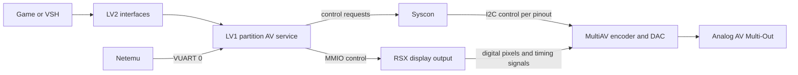

# PS3 native 240p / 288p: verification pass

**Verdict (2026-11-01):** High confidence: supported analog modes stop at 480i/576i, and neither the checked Linux client nor netemu dispatcher offers native 240p/288p. Fresh static analysis locates a deeper software floor in LV1's AV-manager mode-to-timing tables; it does **not** establish an encoder hardware prohibition. Native 240p/288p on Evilnat 4.93/Cobra and CECH-25xx therefore remains **UNKNOWN**, with no reproducible native-output success found in this search. The best research route is to trace the AV-manager timing-table consumer and encoder programming offline; GPU attribute `0x100` is a dead end in the checked LV1 path. Fat-model silicon does not establish an exception. Confidence in feasibility itself is low: there is no waveform measurement or verified custom-timing implementation here.

## Scope and evidence

Research and read-only static analysis only. The historical `RESEARCH_agy_draft.md` remains untouched. PROVEN means checked source or binary; INFERRED means a deduction; CLAIMED means attributed testimony; UNKNOWN means unresolved; WRONG means contradicted or an unsupported assertion presented as established fact. Local firmware and analysis artifacts remain under gitignored `local_only/`. Public documentation contains addresses and one-line descriptions only.

## Claim audit

| Draft claim | Verdict | Evidence | Correction / limit |
|---|---|---|---|
| VUART write uses hypercall 162 | WRONG | [Linux lv1call.h](https://github.com/torvalds/linux/blob/master/arch/powerpc/include/asm/lv1call.h), calls 162/163 | Read=162; write=163. |
| GPU context attribute is hypercall 225, six inputs | PROVEN | Same header, `gpu_context_attribute` declaration | Number is right; firmware function mapping needs independent tracing. |
| 4.93 entry 0x20d060 implements call 225 | WRONG | `fw493/lv1.elf`, registration initializer 0x200930 versus 0x200940; descriptors 0x32adb0 / 0x32ac78 | Fresh decode and data mapping identify 0x210acc for 225; 0x20d060 belongs to 221. |
| netemu 0x11b35c sends VUART packets | WRONG | `stock.elf`, VA 0x11b35c | This reads a configuration byte at object offset 0x2b; the packet path calls 0x11810c at 0x117714. |
| Syscon error 2022 is invented | WRONG | [Syscon Error Codes](https://www.psdevwiki.com/ps3/Syscon_Error_Codes#2022_(DVE)): “DVE Error” | The public label exists. Its existence does not establish the draft's proposed timing-failure mechanism. |
| 262-line input causes subcarrier unlock, DAC mute and error 2022 | UNKNOWN | Same public error page; no corresponding 240p test or encoder datasheet found yet | Unsupported causal claim; remove from verdict. |
| Sony documents standard analog output with a 480i/576i floor | PROVEN | [Sony output settings](https://manuals.playstation.net/document/en/ps3/current/settings/videooutput.html): “NTSC: 480i” / “PAL: 576i” for composite/S-video | Supported modes are evidence about the supported interface, not all silicon capabilities. |
| All protocol modes use the same 0..0x0c IDs | WRONG | [Linux AV header](https://github.com/torvalds/linux/blob/master/arch/powerpc/include/asm/ps3av.h), three distinct enumerations | Linux selection IDs, VIDEO_VID and AV_VID differ; VIDEO_VID includes 0x10 (`480I_A`). |
| Video-mode request is 44 bytes with header size=44 | WRONG | Same header, `ps3av_pkt_video_mode`; [header setter](https://github.com/torvalds/linux/blob/master/drivers/ps3/ps3av.c) | Total is 48 bytes; size excludes the first four bytes and is 44. Draft omitted fields and reserved slots. |
| CRTC index 0x39 bit 0 toggles interlace; zero disables it | WRONG | [Nouveau crtc.c](https://github.com/torvalds/linux/blob/master/drivers/gpu/drm/nouveau/dispnv04/crtc.c), `nv_crtc_mode_set_regs`: “interlace off” | Desktop code uses 0xff to disable; interlaced value derives from horizontal total. Applicability to RSX remains unproven. |
| Envytools completely documents PS3 timing programming | WRONG | [PCRTC documentation](https://envytools.readthedocs.io/en/latest/hw/display/nv3/pcrtc.html): “write me” | Generic NVIDIA ranges and partial VGA extensions are documented; this is not a verified PS3 mode-setting procedure. |
| netemu mode index 3 exists as a usable profile | WRONG | `stock.elf`, VA 0x1174ac | Re-derived ten-entry relative jump table sends index 3 to the failure path at 0x117484; indices 0,1,2,4..9 have profiles. |
| netemu invokes GPU mode setup at 0x13734 | WRONG | `stock.elf`, VA 0x13734 | This is not the claimed call site; fresh import places this region among non-code/table data. |
| Attribute 0x100 accepts custom width/height/scan timings | WRONG | 4.93 `lv1.elf`, VA 0x21159c → 0x222f28; 3.55 VA 0x211044 → 0x222468 | In this dispatch path the callee immediately returns. The draft's recipe cannot program a CRTC through it. |
| AV Manager rejects every mode above 0x0c | WRONG | 3.55 `sysmgr_ss.elf`, VA 0x800249d8; 4.93 VA 0x80025d10 | VID conversion tables cover 1..0x1a and 1..0x29, with holes and state-dependent restrictions. |
| A height of 240 necessarily causes INVALID_VID=5 | WRONG | 3.55 `sysmgr_ss.elf`, VA 0x80024c2c; 4.93 VA 0x80025fd0 | Checked height conditions impose maxima, not equality to a standard mode. A smaller surface is not a new raster. |
| Slim <3%, fat <5%, emulator <3%, hardware bypass 35–50% | WRONG | Draft supplies no observations, population, calculation or model for these numbers | Removed rather than replaced with arbitrary odds. |
| CXM4024R is used in fats; CXM4027R in slims including 25xx | CLAIMED | [MultiAV model table](https://www.psdevwiki.com/ps3/MultiAV); [iFixit teardown](https://www.ifixit.com/Teardown/PlayStation+3+Super+Slim+Teardown/10670), “Sony CXM4027R MultiAV driver” | Chip identity is supported; no encoder timing capability follows from the marking. |
| CXM4024R is a single broadcast ASIC with triple 10-bit DACs | UNKNOWN | [CXM4024R](https://www.psdevwiki.com/ps3/CXM4024R): “Multi chip package” | Page identifies CXD3312/CXA3683; no checked datasheet establishes the draft's DAC precision or internal sync logic. |
| Both chips have a simple 24-bit RGB input bus | UNKNOWN | Same fat pinout labels R/G/B 0..11; [slim pinout](https://www.psdevwiki.com/ps3/CXM4027R) has uncertain signals | Fat page suggests a wider interface. Actual transfer width, packing and color depth require verification. |
| RSX feeds MultiAV, which drives analog pins | CLAIMED | [MultiAV](https://www.psdevwiki.com/ps3/MultiAV), “wide bus input”; chip pinouts | Sourced architecture, not independent continuity testing on the user's board. |
| RSX output literally splits one 24-bit bus to HDMI and DVE | UNKNOWN | [sandungas / vyktormvmpay25 pinout work](https://www.psx-place.com/threads/fault-finding-ylod-with-the-syscon-first-steps-and-error-reporting.30100/page-143) | Reports duplicated links and distinct CLKOUT0/1, not a demonstrated passive split. |
| Encoder owns a mandatory 525/625-line field state machine and mutes on missing half-lines | UNKNOWN | No checked chip datasheet or repeatable custom-timing experiment | Connection diagrams cannot prove this internal behavior. |
| Encoder support is impossible because 240p is not a broadcast standard | WRONG | No supporting hardware evidence; AV service's standard profiles explain supported output without this premise | Unsupported inference. Nonstandard use is precisely the capability being investigated. |
| Broadcast encoders after 2004 rarely support progressive SD | UNKNOWN | No survey, datasheet set or comparative evidence in draft | Dropped. |
| RSX is an NV47/G70-family derivative | CLAIMED | [RSX](https://www.psdevwiki.com/ps3/RSX), “G70/G71”; independent generic NVIDIA documentation | Family ancestry does not make desktop display registers interchangeable. |
| RSX is proven to use the complete desktop `dispnv04` register interface | UNKNOWN | [Envytools PCRTC](https://envytools.readthedocs.io/en/latest/hw/display/nv3/pcrtc.html), generic NV3:G80 | Checked PS3 AV code programs MMIO, but no complete desktop indexed-VGA equivalence was established. |
| Desktop vertical-total registers and overflow bits exist | PROVEN | [Nouveau nvreg.h](https://github.com/torvalds/linux/blob/master/drivers/gpu/drm/nouveau/dispnv04/nvreg.h), VDT index 0x06 / overflow / extensions | Generic NVIDIA fact only. |
| Writing VTOTAL=0x05 plus overflow produces a verified PS3 262-line raster | UNKNOWN | No PS3 register-level verification; [Nouveau crtc.c](https://github.com/torvalds/linux/blob/master/drivers/gpu/drm/nouveau/dispnv04/crtc.c) derives encoded totals | Draft's numeric recipe is withdrawn. |
| Progressive SD requires removing interfield half-line alternation | INFERRED | Raster distinction; timing references in [Envytools VGA docs](https://envytools.readthedocs.io/en/latest/hw/display/nv3/vga.html) | Defining property, not evidence that RSX or either encoder can be configured that way. |
| AV Manager runs inside “LV1 / Syscon” as one subsystem | WRONG | [AV Manager](https://www.psdevwiki.com/ps3/AV_Manager); [hypervisor documentation](https://www.psdevwiki.com/ps3/Hypervisor_Reverse_Engineering#AV_Manager), “Process 9” | A service in the HV partition communicates with the separate Syscon controller. |
| AV guest port is 0 and PS3 match ID is 4 | PROVEN | [Linux device-init.c](https://github.com/torvalds/linux/blob/master/arch/powerpc/platforms/ps3/device-init.c), “av default”; netemu VA 0x117700 | Linux obtains the repository port with fallback 0; match ID is a device class, not a port number. |
| A CID permission table proves mode-value validation | WRONG | Draft offsets contain command-like data, not the checked AV payload validator | Access permission, command dispatch and payload validation are different checks. |
| VIDEO_MODE/FORMAT/PITCH and AVB command numbers | PROVEN | [Linux AV header](https://github.com/torvalds/linux/blob/master/arch/powerpc/include/asm/ps3av.h), command definitions | Respectively 0x01000002/04/05 and 0x04000001; no custom sync fields in their checked definitions. |
| 3.55 VSH exports 45 avset functions including setdve/setdveparam | UNKNOWN | 3.55 `vsh.elf`, VA 0x6b33c8 name set | 44 diagnostic names found; exports/signatures not re-derived. Claimed DVE names absent from that set. |
| VSH has no other custom-timing path whatsoever | UNKNOWN | String presence is not exhaustive control-flow analysis | Not claimed proven in this pass. |
| `sys_rsx_context_attribute` is syscall 0x31 | WRONG | [RPCS3 syscall table](https://github.com/RPCS3/rpcs3/blob/master/rpcs3/Emu/Cell/lv2/lv2.cpp), syscall 674 | Correct listed number is 674 / 0x2a2. |
| Illegal configuration error is 0x8002b202 | WRONG | [RPCS3 video header](https://github.com/RPCS3/rpcs3/blob/master/rpcs3/Emu/Cell/Modules/cellVideoOut.h) | `ILLEGAL_CONFIGURATION` is 0x8002b221; illegal parameter is 0x8002b222. |
| RPCS3 proves actual Sony LV2/SDK rejection behavior | WRONG | [RPCS3 cellVideoOut.cpp](https://github.com/RPCS3/rpcs3/blob/master/rpcs3/Emu/Cell/Modules/cellVideoOut.cpp) is an emulator implementation | It proves what RPCS3 implements. Official supported-mode evidence comes from Sony; full stock SDK behavior remains unverified. |
| `cellVideoOut` has 240/288 resolution constants | WRONG | RPCS3 header / resolution lookup | Checked interface representation has no such constants; SD IDs denote full 480/576 images. |
| Linux exposes no arbitrary raster through ps3fb | PROVEN | [ps3fb.c](https://github.com/torvalds/linux/blob/v6.12/drivers/video/fbdev/ps3fb.c), mode matcher and `ps3fb_set_par` | It can accept smaller framebuffer sizes inside a selected fixed raster, so “no custom framebuffer” would overstate this. |
| Attribute 0x101 directly chooses HSYNC/VSYNC output pulse timings | WRONG | [Linux GPU wrappers](https://github.com/torvalds/linux/blob/v6.12/arch/powerpc/include/asm/ps3gpu.h); [RPCS3 attributes](https://github.com/RPCS3/rpcs3/blob/master/rpcs3/Emu/Cell/lv2/sys_rsx.cpp), “Display sync set” | Flip synchronization is not a raw horizontal/vertical modeline. |
| Netemu has a 10-entry dispatcher and no 240/288-height profile there | PROVEN | `stock.elf`, VA 0x117478 and 0x1174ac | Function/table distinction and conditional SD VIDs detailed below. |
| Netemu indices 4,6,8 are 60 Hz; 5,7,9 are 50 Hz | WRONG | `stock.elf`, VA 0x117cd0 profiles plus Linux VID meanings | These pairs are reversed in the draft. |
| Netemu always uses a simple 480i VIDEO_VID for index 0 | WRONG | `stock.elf`, VA 0x1174d4 | Conditional selection includes 0x10 or 5, distinct from backend VID 0. |
| Netemu goes directly to LV1, bypassing LV2 for AV transport | PROVEN | `stock.elf`, VA 0x118140; [Linux HV call declarations](https://github.com/torvalds/linux/blob/master/arch/powerpc/include/asm/lv1call.h) | A concrete example of why an LV2-only restriction cannot explain every output path. Exact live LPAR assignment was not measured. |
| Netemu is definitely LPAR 2 named PS2_NE_LPAR | UNKNOWN | No live partition state; generic [HV repository model](https://www.psdevwiki.com/ps3/Hypervisor_Reverse_Engineering) is not this launch's proof | Port 0 and direct HV access are established independently of the label. |
| Every original PS1 game internally runs 240p | WRONG | [PSX-SPX GPU documentation](https://psx-spx.consoledev.net/graphicsprocessingunitgpu/), display-mode registers | PS1 also supports interlaced high-resolution display; use “240p-origin content” when that is what is meant. |
| PS1 on PS3 analog normally becomes 480i/576i or higher standard output | CLAIMED | [Peppe90, PSX-Place](https://www.psx-place.com/threads/480i-ps1-games-on-ps3.40803/); [RetroRGB](https://retrorgb.com/playstation3.html) | Consistent ordinary-use reports, not an all-firmware hardware impossibility proof. |
| Exact PS1 field/line doubling algorithm is proven | UNKNOWN | [ConsoleMods PS3 section](https://consolemods.org/wiki/AV:RetroTINK-4K/System_Specific_Settings#Sony_PlayStation_3) describes a field render of an upscale | No PS1-emulator disassembly or field capture here; field cadence, filtering and odd/even duplication need checking. |
| All fat PS3s contain full EE+GS PS2 hardware | WRONG | [PS2 emulation](https://www.psdevwiki.com/ps3/PS2_Emulation), model distinctions | A/B have EE+GS; C/E use GS with software EE; later fats do not inherit full hardware BC. |
| BC fats route GS output through RSX and cannot bypass PS3 processing | CLAIMED | [ConsoleMods BC PS2 section](https://consolemods.org/wiki/AV:RetroTINK-4K/System_Specific_Settings#PS2_Disk_Games_on_Backwards_Compatible_PS3_models); [PS2 emulation](https://www.psdevwiki.com/ps3/PS2_Emulation) | Standard processed output is documented; the exact physical GS→RSX path was not independently traced. |
| “No one ever achieved PS3 240p” is proven by a comprehensive survey | UNKNOWN | Search log and opened sources below | No reproducible success found; no claim of exhaustive historical coverage. |
| RetroArch PS3 has working CRT SwitchRes modelines | UNKNOWN | [Libretro SwitchRes docs](https://docs.libretro.com/guides/crtswitchres/) discuss Windows/Linux; PS3 source fetch failed | No PS3-native SwitchRes path established. The draft's exact PSGL/ps3gl/libgcm dependency story was not independently verified. |
| All RetroArch cores always use a 640/720×480 analog container | UNKNOWN | [Stone_McCoy / hunterk](https://forums.libretro.com/t/ways-to-reduce-screen-flickering-on-a-crt-tv-ps3/26748) reports composite interlace flicker | Firsthand case, not an exhaustive statement about all ports, cores, PAL modes or future patches. |
| Blanking alternating fields makes native 240p | WRONG | Interlace cadence remains unchanged; [Libretro discussion](https://forums.libretro.com/t/retroarch-wii-crt-journey-a-request-for-help/48624), DariusG | At nominal 60 fields/s, alternating blank fields repeat lit content at ~30/s; no change to sync. |
| LV2 direct register writes will definitely produce a 240p digital stream | UNKNOWN | No established PS3 register recipe or test | Hardware capability and privilege access must both be established first. |
| Cobra peek/poke makes the proposed patch feasible by itself | WRONG | [Cobra implementation](https://github.com/Joonie86/COBRA-7.3/blob/master/484/REX/stage2/main.c), PS3MAPI branches | Memory access is a prerequisite, not a mode generator. Installed 4.93 API availability and service-address mapping remain unverified. |
| Changing netemu height to 240 proves 240p or guarantees an encoder fault | WRONG | `stock.elf` VA 0x1173d4; AV-manager timing selection described below | Buffer size and output cadence are separate. Neither outcome follows from that change alone. |
| Netemu patch risk is zero; direct MMIO resets are 100% safe | UNKNOWN | No experiment or recovery proof; [Sony reset guidance](https://manuals.playstation.net/document/en/ps3/current/settings/videooutput.html) only concerns supported settings | Crashes, hangs and lost output cannot be excluded; do not promise a universal recovery. |
| A black screen after the proposed write proves the encoder is the blocker | WRONG | Experiment has multiple uncontrolled layers | Wrong registers, PLL, blanking, muxing or rejected command could all cause no signal. |
| External DAC / FPGA bypass necessarily preserves native Multi-Out | UNKNOWN | No bus characterization or prototype | It might create a different external output; replacing the original connector's driver needs separate electrical design. |
| Installed environment specifically uses Cobra 8.5 | UNKNOWN | User specifies Evilnat 4.93 + Cobra; no live system queried | Exact Cobra revision and enabled interfaces were not verified. |

## Public sources and prior art

All accesses below were on **2026-11-01**. “Undated” means the opened view did not expose a reliable publication/revision date; it is not an invented date. Quotes are short and source-specific. A search result is not marked opened merely because its text was visible in an index. Community assertions remain CLAIMED even when the page was successfully opened. Source code is primary evidence for that code's behavior, not automatically for the Sony implementation.

| ID / source URL | Date; author / handle | Opened? | Short quote / symbol and what it establishes |
|---|---|---|---|
| S01 [Sony output settings](https://manuals.playstation.net/document/en/ps3/current/settings/videooutput.html) | Undated; Sony | Yes | “NTSC: 480i”; supported composite/S-video is SD interlaced, with PAL 576i. |
| S02 [Linux lv1call.h](https://github.com/torvalds/linux/blob/master/arch/powerpc/include/asm/lv1call.h) | Header credits 2006; Sony/Linux contributors | Yes, raw equivalent | `write_virtual_uart`; read/write numbers 162/163 and GPU attribute 225. |
| S03 [Linux ps3av.h](https://github.com/torvalds/linux/blob/master/arch/powerpc/include/asm/ps3av.h) | Header credits 2007; Sony/Linux contributors | Yes, raw equivalent | “invalid video format”; protocol declarations, three mode-ID namespaces and status values. |
| S04 [Linux ps3av.c](https://github.com/torvalds/linux/blob/master/drivers/ps3/ps3av.c) | Header credits 2007; Sony/Linux contributors | Yes, raw equivalent | `ps3av_set_hdr`; length convention, packet transport, mode table and client checks. |
| S05 [Linux ps3av_cmd.c](https://github.com/torvalds/linux/blob/master/drivers/ps3/ps3av_cmd.c) | Header credits 2006–07; Sony/Linux contributors | Yes, raw equivalent | `ps3av_vid_video2av_table`; VID conversion and packet construction. |
| S06 [Linux v6.12 ps3fb.c](https://github.com/torvalds/linux/blob/v6.12/drivers/video/fbdev/ps3fb.c) | v6.12 tag; Sony/Geert Uytterhoeven and contributors | Yes, raw equivalent | “progressive/interlaced must match”; fixed raster matching, cropped/full framebuffers and GPU calls. |
| S07 [Linux v6.12 ps3gpu.h](https://github.com/torvalds/linux/blob/v6.12/arch/powerpc/include/asm/ps3gpu.h) | Header credits 2009; Sony/Linux contributors | Yes, raw equivalent | `L1GPU_CONTEXT_ATTRIBUTE_DISPLAY_SYNC`; exact GPU wrapper parameters. |
| S08 [Linux device-init.c](https://github.com/torvalds/linux/blob/master/arch/powerpc/platforms/ps3/device-init.c) | Revision undated; Linux contributors | Yes, raw equivalent | “av default”; repository-selected VUART port, fallback 0. |
| S09 [RPCS3 sys_rsx.cpp](https://github.com/RPCS3/rpcs3/blob/master/rpcs3/Emu/Cell/lv2/sys_rsx.cpp) | Revision undated; RPCS3 contributors | Yes, raw equivalent | “Display mode set”; 0x100 case is a no-op in RPCS3; other attributes have different buffer/flip roles. |
| S10 [RPCS3 cellVideoOut.cpp](https://github.com/RPCS3/rpcs3/blob/master/rpcs3/Emu/Cell/Modules/cellVideoOut.cpp) | Revision undated; RPCS3 contributors | Yes, raw equivalent | `_IntGetResolutionInfo`; supported-resolution lookup, not direct Sony SDK evidence. |
| S11 [RPCS3 cellVideoOut.h](https://github.com/RPCS3/rpcs3/blob/master/rpcs3/Emu/Cell/Modules/cellVideoOut.h) | Revision undated; RPCS3 contributors | Yes, raw equivalent | `CELL_VIDEO_OUT_ERROR_ILLEGAL_CONFIGURATION`; correct error values and resolution IDs. |
| S12 [RPCS3 syscall table](https://github.com/RPCS3/rpcs3/blob/master/rpcs3/Emu/Cell/lv2/lv2.cpp) | Revision undated; RPCS3 contributors | Yes, raw equivalent | `sys_rsx_context_attribute`; listed at 674 / 0x2a2. |
| S13 [Envytools display index](https://envytools.readthedocs.io/en/latest/hw/display/index.html) and [PCRTC](https://envytools.readthedocs.io/en/latest/hw/display/nv3/pcrtc.html) | Undated; envytools authors | Yes | “write me”; generic NV3:G80 coverage with substantial missing detail. |
| S14 [Envytools nv3_pcrtc.xml](https://github.com/envytools/envytools/blob/master/rnndb/display/nv3_pcrtc.xml) | Revision undated; envytools authors | Yes, raw equivalent | `PCRTC2`; MMIO blocks and vblank registers, not a PS3 timing recipe. |
| S15 [Nouveau nvreg.h](https://github.com/torvalds/linux/blob/master/drivers/gpu/drm/nouveau/dispnv04/nvreg.h) | Revision undated; Nouveau/NVIDIA/XFree86 contributors | Yes, raw equivalent | `NV_CIO_CRE_ILACE__INDEX`; desktop index 0x39 and vertical overflow fields. |
| S16 [Nouveau crtc.c](https://github.com/torvalds/linux/blob/master/drivers/gpu/drm/nouveau/dispnv04/crtc.c) | Revision undated; NVIDIA/Nouveau contributors | Yes, raw equivalent | “interlace off”; 0xff disables interlace in this desktop implementation. |
| S17 [PSDevWiki MultiAV](https://www.psdevwiki.com/ps3/MultiAV) | Undated; wiki contributors | Yes | “wide bus input”; chip-to-model inventory and RSX→MultiAV→connector description. |
| S18 [PSDevWiki CXM4024R](https://www.psdevwiki.com/ps3/CXM4024R) | Undated; wiki contributors | Yes | “Multi chip package”; fat part, subchips, RGB input labels, sync/clock and I2C pinout with uncertainties. |
| S19 [PSDevWiki CXM4027R](https://www.psdevwiki.com/ps3/CXM4027R) | Undated; wiki contributors | Yes | “Digital Video Encoder pinout”; includes CECH-25xx/JSD-001; substantial unknowns remain. |
| S20 [iFixit Super Slim teardown](https://www.ifixit.com/Teardown/PlayStation+3+Super+Slim+Teardown/10670) | 2012-10-02; Brett Hartt and contributors | Yes | Chip marking/identification in step 14; independently supports CXM4027R use on Super Slim, not every Slim board. |
| S21 [PSX-Place pinout discussion, page 143](https://www.psx-place.com/threads/fault-finding-ylod-with-the-syscon-first-steps-and-error-reporting.30100/page-143) | 2022-06-09/10; sandungas, vyktormvmpay25 | Yes | “pinout of the CXM4024R”; first-person tracing and uncertain RSX sync-pin connections. |
| S22 [PSDevWiki Syscon Error Codes](https://www.psdevwiki.com/ps3/Syscon_Error_Codes#2022_(DVE)) | Undated; wiki contributors | Yes | “DVE Error”; error 2022 exists, with several contexts and no documented 262-line causal test. |
| S23 [PSDevWiki AV Manager](https://www.psdevwiki.com/ps3/AV_Manager) | Undated; wiki contributors | Yes | “part of the sysmgr within LV1”; service/control architecture. |
| S24 [PSDevWiki Hypervisor Reverse Engineering](https://www.psdevwiki.com/ps3/Hypervisor_Reverse_Engineering#AV_Manager) | Undated; wiki contributors | Yes | “Process 9”; VUART endpoints, RSX MMIO mapping and commands beyond Linux's subset. |
| S25 [PSDevWiki RSX](https://www.psdevwiki.com/ps3/RSX) | Undated; wiki contributors | Yes | “G70/G71”; ancestry and modified design, not demonstrated display-register interchangeability. |
| S26 [PSDevWiki PS2 Emulation](https://www.psdevwiki.com/ps3/PS2_Emulation) | Undated; wiki contributors | Yes | `ps2_emu` / `ps2_gxemu`; model and emulator distinctions. |
| S27 [RetroRGB PS3](https://retrorgb.com/playstation3.html) | Undated; RetroRGB, page byline unavailable | Yes | “240p isn’t supported from any output”; ordinary output/PS1 experience, not chip-level proof. |
| S28 [PSX-Place: 480i PS1 games](https://www.psx-place.com/threads/480i-ps1-games-on-ps3.40803/) | 2023-06-13; Peppe90, mrjaredbeta | Yes | “converts 240p/288p Ps1 games to 480i/576i”; developer suggests ps1_netemu for artifacts, not 240p output. |
| S29 [PSX-Place: custom output resolution](https://www.psx-place.com/threads/any-specualations-on-ways-to-use-a-custom-output-resolution-720p90hz-240p.45507/) | 2024-12-12/15; quake, mimi | Yes | “can the RSX/DAC handle those resolutions”; a question and unsupported replies, no implementation or measurement. |
| S30 [Libretro: PS3 CRT flickering](https://forums.libretro.com/t/ways-to-reduce-screen-flickering-on-a-crt-tv-ps3/26748) | 2020-03-05; Stone_McCoy, hunterk | Yes | “480i interlacing flicker”; firsthand composite setup and tentative diagnosis. |
| S31 [Libretro SwitchRes docs](https://docs.libretro.com/guides/crtswitchres/) | Undated; Libretro docs contributors | Yes | “available on both Windows and Linux”; no PS3 implementation established by this page. |
| S32 [Reddit r/crtgaming comparison](https://www.reddit.com/r/crtgaming/comments/108sx8v/friendly_reminder_ps3s_cant_output_240p_as_much/) | 2023-01-11 (index date); indyseal | Yes | “Ape Escape (PS1 game) running on a PS3 (480i) vs. PS2”; photographs/report, not measured timing. |
| S33 [Reddit r/PS3 BC processing](https://www.reddit.com/r/PS3/comments/1spmok6/do_bc_models_process_240p_ps2_games_correctly/) | 2026-04-19/20 (index dates); ajddavid452, mathias4595, zekepliskin | Yes | “I was trying to force Ico into 240p”; CECHA00/GSM attempt reported failure/cropping, without a waveform. |
| S34 [GBAtemp PS2 vs PS3](https://gbatemp.net/threads/is-a-ps2-worth-it-if-i-already-have-a-ps3-and-emulation-capable-systems.625139/) | 2023-01 thread; Zaide, reply quoted by 5witchy on 2023-01-25 | **No: 403; index only** | “PS3 does not allow 240p output”; testimony includes fully BC systems, not a documented bypass attempt. |
| S35 [ConsoleMods PS3/BC PS2 settings](https://consolemods.org/wiki/AV:RetroTINK-4K/System_Specific_Settings#Sony_PlayStation_3) | Undated; wiki contributors, opened view lacks per-section author | Yes | “field render of the 480p upscale”; explicitly describes processed PS1 and BC PS2 interlaced output, but no emulator algorithm proof. |
| S36 [Libretro field-blanking discussion](https://forums.libretro.com/t/retroarch-wii-crt-journey-a-request-for-help/48624) | 2025-08-31; DariusG, Jamirus | Yes | “30hz and reduced brightness”; explains the distinction between field blanking and native progressive sync. |
| S37 [Cobra 4.84 REX source](https://github.com/Joonie86/COBRA-7.3/blob/master/484/REX/stage2/main.c) | Branch labelled 4.84; Joonie86/Cobra contributors | Yes | `PS3MAPI_OPCODE_LV1_PEEK`; concrete example of multiplexed syscall-8 memory operations, not validation of installed Evilnat 4.93. |
| S38 [PSX-SPX GPU docs](https://psx-spx.consoledev.net/graphicsprocessingunitgpu/) | Undated; nocash/PSX-SPX contributors | Yes | `GP1(08h)` display mode; PS1 vertical/interlace modes vary. |
| S39 [Hackaday PS3 Eye](https://hackaday.com/2015/05/20/ps3-eye-lives-again-thanks-to-low-prices/) | 2015-05-20; James Hobson | Yes | “QVGA (320×240)”; camera input, excluded as native console-output evidence. |
| S40 [My Life in Gaming video](https://www.youtube.com/watch?v=f7fCTHu99bk) | Linked by article dated 2016-01-11; My Life in Gaming | **No: fetch failed** | No video-description quotation verified; do not claim the video was watched or measured. |
| S41 [MLiG video discovery article](https://www.playstationlifestyle.net/2016/01/11/tutorial-video-shows-best-way-to-play-psone-games-across-sonys-consoles-ps1-on-vita/) | 2016-01-11; Michael Briers | Yes | “PS3, meanwhile, uses emulation”; discovery link only, not technical evidence about the encoder. |
| S42 [Patent JP3318633B2](https://patents.google.com/patent/JP3318633B2/en) | Publication 2002-08-26; Sony Corp assignee, inventor not verified | **No: fetch failed; index only** | “Video signal converter”; general interlace conversion, no link established to either CXM part or PS3. |
| S43 [Linux ps3.h](https://github.com/torvalds/linux/blob/master/arch/powerpc/include/asm/ps3.h) | Revision undated; Linux contributors | Yes, raw equivalent | `PS3_MATCH_ID_AV_SETTINGS`; numeric match ID 4. |
| S44 [Envytools VGA registers](https://envytools.readthedocs.io/en/latest/hw/display/nv3/vga.html) | Undated; envytools authors | Yes | “VGA registers and memory”; generic display context, no complete RSX timing specification. |

### What the prior art establishes

**CLAIMED, consistent ordinary behavior:** S27, S28, S30, S32, S33 and S35 support 480i/576i output for 240p/288p-origin emulation on an SD analog connection. S29 remains a request for custom modes, not a successful mod. S33 includes a failed CECHA00 attempt with PS2 GSM. No opened source supplies code plus measured native PS3 analog 240p/288p timing. This search cannot prove nobody has ever achieved it.

**PS1:** S35 describes scaling before interlaced field output and warns of uneven sampling; S28 distinguishes emulators' artifact handling. Calling this “field-doubled 240p” is only a loose description. Exact per-field buffer reuse, spatial duplication, filters and timing are **UNKNOWN** here. A 480i output consists of alternating interlaced fields even if their source content was progressive.

**BC PS2 fats:** S26 distinguishes full EE+GS A/B from GS-only C/E. S35 explicitly discusses those four disc-compatible model groups and processed interlaced SD output. This supports the ordinary floor, not the draft's fully proven physical GS-to-RSX routing story. The presence of real GS silicon alone does not imply original PS2 sync reaches the AV connector. Netemu on the Slim is a separate path and was checked directly above/below.

**Source quality caveats:** RetroRGB's cable paragraph mentions cables capable of 240p while its resolution section explicitly says PS3 lacks 240p; cable capability is not console capability. Its RGB-only-480i statement also conflicts with Sony's listed progressive AV MULTI/SCART modes. S29 contains the misleading assertion that 240p and 480i are identical. S35's word “never” is a community capability claim, not proof about undocumented silicon. None of these contradictions is resolved by counting forum votes.

### Search coverage and negative results

Queries were run through the web search tool, with source opening when useful. Negative means **no relevant result returned in this pass**, not no page exists. Some `site:` queries returned off-site fallback results; those do not count as coverage of the requested community.

| Query or group actually searched | Result / limit |
|---|---|
| `PS3 240p native output CXM4027R CXM4024R`; `site:psdevwiki.com ps3 CXM4024 CXM4027` | Useful chip/RetroRGB leads; opened core sources. |
| `site:reddit.com/r/crtgaming PS3 240p output hack` | Ordinary-use reports and external-downscaler discussion; selected comparison opened. |
| `site:reddit.com/r/ps3homebrew "240p"`; `PS3 "240p" "ps3homebrew"` | No relevant on-sub output implementation; tool returned other communities. |
| `site:reddit.com/r/PS3CFW "240p"`; `PS3 "240p" "PS3CFW"` | No relevant on-sub implementation; off-site/subreddit fallback results. |
| `site:reddit.com/r/ps3 "240p" native` | BC processing discussion located and opened. |
| `site:shmups.system11.org "PS3" "240p" "output"`; `PS3 240p Fudoh`; `PS3 240p "shmups"` | First query returned empty; broader queries yielded no relevant native-output source. |
| `site:avsforum.com "PS3" "240p"`; `PS3 240p "AVS Forum"` | Site query returned empty; broader query yielded no useful native-output evidence. |
| `site:psx-place.com "240p" "PS3"` | Custom-mode request, PS1 analog-output reports and unrelated recording/remote-play “240p” mentions. |
| `site:gbatemp.net ps3 240p output` | Relevant testimony in index; attempted direct page blocked with 403. |
| `site:forums.libretro.com "PS3" "240p"`; `site:github.com/libretro/RetroArch/issues "PS3" "240p"` | Opened firsthand flicker thread; no relevant native-mode issue/implementation found. |
| `site:github.com/libretro/RetroArch "cellVideoOutConfigure"`; `site:github.com/libretro/RetroArch "ps3_ctx.c"` | No usable PS3 source fetched; raw/blob candidates failed. Exact PS3 port dependencies remain unverified. |
| `site:hackaday.com ps3 240p` | Camera article, not analog output; opened and excluded. |
| `"Retro Console Mods" "PS3" "240p"`; `PS3 "240p" "Retro Console Mods"` | No relevant exact-name result; broader search found ConsoleMods, opened separately and not conflated with that name. |
| `site:youtube.com "PS3" "240p" output native`; `"PS3" "240p" site:youtube.com/watch` | No verified native-output description. MLiG link found through article; YouTube fetch failed. |
| `site:patents.google.com Sony "non-interlace" "video" encoder`; `"CXM4027R" patent` | General Sony conversion patents and chip pages; no part-specific timing proof. Patent open attempts failed. |
| `"CXM4027R" datasheet`; `"CXM4024R" "non-interlaced"` | Teardown/wiki and reseller catalogues; no checked programming datasheet. Reseller marketing is not chip documentation. |
| `site:github.com/envytools/envytools nv04 pcrtc interlace`; `"NV_CIO_CRE_ILACE" "0x39"` | Initial path guesses failed; actual nv3/PCRTC docs and Nouveau definitions opened. |
| `site:github.com/fail0verflow "RSX" "display"` | No relevant PS3 timing recipe found; unrelated RSX-name projects excluded. |

No search result labelled 240p is treated as native output without checking whether it means a game framebuffer, recording resolution, camera capture, remote-play stream or external downscaler output.

## Layer model

| Layer | What is established | Evidence level / floor |
|---|---|---|
| Userland/XMB / `cellVideoOut` | Sony's supported mode menu has no 240p/288p; RPCS3's API implementation uses resolution IDs. | PROVEN supported-interface floor; actual Evilnat VSH behavior beyond this is UNKNOWN. |
| LV2 driver | RPCS3 identifies syscall 674 and display attributes; actual 4.93 LV2's complete validation was not decoded. | UNKNOWN independent floor; emulator code is not proof of retail kernel checks. |
| LV1 GPU context attributes | Correct call-225 handlers and attribute-0x100 return-only target are checked. | PROVEN for supplied stock LV1s; no arbitrary-modeline API demonstrated. |
| LV1 AV Manager | Mode conversion, dimension checks and a separate timing-table consumer are located in `sysmgr_ss`. | PROVEN software restriction to stock raster profiles in the checked path; no 240/288 profile. |
| Emulators | Netemu selects fixed standard profiles and writes AVB packets directly, bypassing LV2. | PROVEN local dispatcher floor; other emulators' internals UNKNOWN. |
| RSX | AV-manager code uses RSX output MMIO; generic NVIDIA timing docs exist. | PROVEN register access; custom 15 kHz progressive capability remains UNKNOWN. |
| Encoder/Syscon | Teardown/pinout evidence identifies MultiAV chips and control/data connections. | CLAIMED documented architecture; 240p acceptance, sync ownership and hard floor UNKNOWN. |

The supported floor is visible in userland and emulator policy, with a concrete stock raster-selection mechanism in the LV1 AV service. This does not establish five independent rejection layers or a final hardware prohibition. Component/RGB DAC behavior must be distinguished from composite/S-video color encoding; a composite color-lock theory cannot automatically rule out the others (**INFERRED**).

Control and pixel paths must also be kept separate:

The netemu transport and AV-service MMIO are directly checked. Encoder/control links are sourced community pinout evidence; the diagram does not assert internal sync generation, data-bus width, or a verified GS bypass.

### Encoder and RSX: documented versus guessed

The fat pinout labels RGB bits 0..11, FIELD, HSYNC/VSYNC/CSYNC, CLOCK and Syscon I2C. Several sync connections have question marks or revisions. The slim pinout leaves many more pins unknown. **CLAIMED** pin assignments therefore support investigating a slave-sync route, but neither prove transparent pass-through nor a mandatory internal field-cadence generator. DAC bit depth, subcarrier PLL design, free-running sync, minimum line count, line-repeat modes, Macrovision/WSS integration and nonstandard-timing mute policy are **UNKNOWN** from the sources checked. The fat package's two named subchips also make “single hardwired ASIC” an oversimplification. No chip programming datasheet or independently inspected service manual was obtained; do not describe reseller catalogue entries as datasheets. S21 is useful first-person tracing provenance; S20 confirms a marking in a teardown.

Envytools documents generic PCRTC/PRMCIO blocks, VGA-index access and partial extended vertical bits; its PCRTC chapter explicitly has unfinished sections. Nouveau independently identifies index 0x39, writes a horizontal-total-derived interlace value, and writes 0xff for noninterlaced modes. The RSX family relationship and PSDevWiki's mapped RSX display/PLL windows justify using these as search leads (**INFERRED**), not as a write recipe. Neither the opened PSDevWiki RSX page nor the fail0verflow search yielded a verified PS3 262/312-line programming procedure. The AV-service code is the stronger PS3-specific evidence: it directly programs output MMIO using stock profile records.

## Verified Linux interface

PROVEN in [ps3av.h](https://github.com/torvalds/linux/blob/master/arch/powerpc/include/asm/ps3av.h), [ps3av.c](https://github.com/torvalds/linux/blob/master/drivers/ps3/ps3av.c) and [ps3av_cmd.c](https://github.com/torvalds/linux/blob/master/drivers/ps3/ps3av_cmd.c). IDs below are hexadecimal except Linux's decimal selection column. Dimensions describe native modes, not cropped framebuffers.

| Format | Dimensions | Linux selection | VIDEO_VID | AV_VID |
|---|---|---:|---:|---:|
| 480i | 720×480 | 1 | 01 | 00 |
| 480p | 720×480 | 2 | 05 | 01 |
| 720p60 | 1280×720 | 3 | 09 | 02 |
| 1080i60 | 1920×1080 | 4 | 07 | 03 |
| 1080p60 | 1920×1080 | 5 | 0b | 04 |
| 576i | 720×576 | 6 | 03 | 05 |
| 576p | 720×576 | 7 | 06 | 06 |
| 720p50 | 1280×720 | 8 | 0a | 07 |
| 1080i50 | 1920×1080 | 9 | 08 | 08 |
| 1080p50 | 1920×1080 | 10 | 0c | 09 |
| WXGA | 1280×768 | 11 | 0d | 0a |
| SXGA | 1280×1024 | 12 | 0e | 0b |
| WUXGA | 1920×1200 | 13 | 0f | 0c |
| NONE / AUTO | — | 0 (AUTO) | 00 (NONE) | — |
| 480I_A | not specified by Linux's mode table | — | 10 | — |

No named 240p, 288p, field-repeat or custom-timing ID is defined. `480I_A` is **not** evidence of 240p. The default interlaced framebuffer crops are 576×384 and 576×460; fullscreen (`0x80`) preserves the corresponding 480i/576i raster. [ps3fb.c](https://github.com/torvalds/linux/blob/v6.12/drivers/video/fbdev/ps3fb.c) marks 480i/576i/1080i interlaced and the other table modes noninterlaced. Its mode matcher selects an existing native mode and pads margins; a smaller framebuffer does not request a smaller scan raster.

Transport uses AV-settings VUART, guest port 0 (the repository binding and independent netemu sender are checked below). Header: 16-bit version `0x0205`, 16-bit length excluding the first four bytes, 32-bit CID. Reply adds 32-bit status and sets the reply bit. Video request CID is `0x01000002`; AVB bundle CID is `0x04000001`. Mode packet offsets: head +8, reserved +12, VID +16, width +22, height +26, pitch +28, output format +32, framebuffer format +36, conversion byte +41, order +42, reserved +44; total 48, length 44. There are no total/sync/clock fields. Status 5 means invalid VID; status 14 separately means invalid video parameters. A declared error code does not prove a particular firmware branch returns it for height 240.

Linux's [GPU wrappers](https://github.com/torvalds/linux/blob/v6.12/arch/powerpc/include/asm/ps3gpu.h) use call 225: `0x101` takes head, sync choice/offset argument, 0, 0; `0x102` takes head, framebuffer offset, 0, 0; `0x600` takes XDR LPAR address, size, IOIF offset, 0; `0x601` takes destination offset, source IOIF address, packed sync/width/height, packed pitches. `0x602` and `0x603` are blit-sync and close. The generic wrapper names the second sync parameter `ddr_offset`; caller context is needed to interpret it. Linux requests raster modes through AV packets rather than exposing a raw modeline through attribute `0x100`.

Specifically, ps3fb initializes sync for heads 0/1 with value 2 (VSYNC); flips select head and DDR frame offset. Blits pack `(1<<32)` for completion plus width in bits 16..31 and height in bits 0..15; the pitch argument holds destination pitch, plus source pitch in the upper half when they differ. Framebuffer setup passes the command-buffer size of 2 MiB and IOIF base `0x0d000000`. These are buffer/copy/synchronization parameters, not totals/porches. The pixel-format IDs are distinct again: BLACK=0 and ARGB_8BIT=7, RGB/BGR order=0/1, X8R8G8B8 framebuffer format=0. None adds custom scan timing. **PROVEN** in S05–S07.

## Local binary verification

Addresses in this section are **ELF virtual addresses** unless explicitly called file offsets. Input ELFs were opened read-only; fresh pyghidra imports and decoded listings are private scratch. No Sony instruction listings or decompiler output are published here. Hashes identify exact inputs, not an independently authenticated Sony distribution.

| Input (under sibling project's `local_only/`) | SHA-256 |
|---|---|
| `stock.elf` (4.93 netemu) | `63f12b7e00959c758f8aedfd23d1b8bc78e8ae7d922048e4765aaaef1dbbc6d3` |
| `fw493/lv1.elf` | `e8d0b532adf6ba6c6c1ea40a5c5b86407abe11ea7a3ab8624ca5b09d3e4c3d6b` |
| `fw355/out/lv1.elf` | `50874357202e1454bea536c3bb14b454e3a28a88b77ef2cfde711d23e9a3aca7` |
| `fw355/out/vsh.elf` | `4d146f572f4a55450305b94d7f122221cebe53da4e7b5e7d110531db1df88884` |
| `analysis/p0h/modules/sysmgr_ss.elf` (3.55 extraction) | `4b2583fcba7c0a3486323508d3f6785e1274717e41a91da20b60f8b2af7adaf5` |
| `analysis/p0i/modules/sysmgr_ss.elf` (4.93 extraction) | `07c0bd2a2403f65b6d741e11a15106114365cb78165833bac726476f671b64c9` |

### Netemu

| Address | Finding | Level |
|---|---|---|
| 0x1173d4 | Configuration function, not a static resolution table itself. | PROVEN |
| 0x117478 | Requires an unsigned mode index ≤9; index 3 still takes failure path. | PROVEN |
| 0x1174ac | Ten relative jump entries independently decoded from ELF bytes. | PROVEN |
| 0x1174d4 | Index 0: 640×480, backend VID 0; video VID is conditional 0x10 or 5. | PROVEN |
| 0x117da8 | Index 1: 720×480, video VID 5/backend VID 1. | PROVEN |
| 0x117d60 | Index 2: 640×576, backend VID 5 or 6; video VID 0x11 or 6. | PROVEN |
| 0x117484 | Index 3 failure target; no usable 576p profile at this index. | PROVEN |
| 0x117d48 | Index 4: 1280×720, VIDEO/AV IDs 0x0a/7 (50 Hz). | PROVEN |
| 0x117d30 | Index 5: 1280×720, VIDEO/AV IDs 9/2 (60 Hz). | PROVEN |
| 0x117d18 | Index 6: 1920×1080, VIDEO/AV IDs 8/8 (1080i50). | PROVEN |
| 0x117d00 | Index 7: 1920×1080, VIDEO/AV IDs 7/3 (1080i60). | PROVEN |
| 0x117ce8 | Index 8: 1920×1080, VIDEO/AV IDs 0x0c/9 (1080p50). | PROVEN |
| 0x117cd0 | Index 9: 1920×1080, VIDEO/AV IDs 0x0b/4 (1080p60). | PROVEN |
| 0x1175c0 | Constructs nested VIDEO_MODE request within AVB bundle; length 0x2c excludes four-byte prefix. | PROVEN |
| 0x11b35c | Configuration-byte accessor at object +0x2b, used for color-conversion settings. | PROVEN |
| 0x117714 | Calls actual packet sender with port 0, packet pointer and length. | PROVEN |
| 0x11810c | Sender handles partial writes and loops until complete. | PROVEN |
| 0x118140 | Selects hypercall 163 with netemu's trap selector high bit; trap issued at 0x118154. | PROVEN |
| 0x2626b4 | Reads configuration through 0x11b258, then negotiates capabilities; not a simple direct switch on a numeric output mode. | PROVEN |
| 0x11b258 | Reads a 32-bit configuration value at object +0x1c. | PROVEN |
| 0x26d7f8 | Uses that accessor for a diagnostic display; “Video Mode” string is at 0x304b10. | PROVEN |

The draft reverses the 50/60 Hz labels for indices 4..9. Internal mode 0 is not simply Linux VIDEO_VID 0. The conditional SD VIDEO IDs and frontend/backend distinction require further investigation. No 240/288-height profile occurs in this checked dispatcher; this is not an exhaustive proof that every emulator path lacks an undocumented capability. Changing a rendered height alone cannot establish progressive analog timing (**INFERRED**).

### LV1 hypercall registration

| Firmware | Call | Registration record | Initializer store | Descriptor | Function entry |
|---|---:|---:|---:|---:|---:|
| 4.93 | 225 | 0x3c23d0 | 0x200930 | 0x32adb0 | 0x210acc |
| 4.93 | 221 | 0x3c23e0 | 0x200940 | 0x32ac78 | 0x20d060 |
| 3.55 | 225 | 0x3abd78 | 0x2008f4 | 0x322fc0 | 0x210628 |
| 3.55 | 221 | 0x3abd88 | 0x200904 | 0x322e88 | 0x20d010 |

**PROVEN:** record numbers, TOC-resolved initializer stores and descriptor contents agree. TOCs are 0x35a038 (4.93) and 0x351198 (3.55). The draft picked the correct numbered record but paired it with the next handler. Call 221 is GPU context allocation, not context attribute. The claimed dispatchers 0x213998/0x21340c were not established as the call-225 mode path. Attribute `0x100` reaches a return-only function at 0x222f28 in 4.93 and 0x222468 in 3.55. The latter's bytes match the freshly decoded 4.93 return. RPCS3's corresponding no-op corroborates, but does not substitute for, this binary check.

### AV module and VSH bounds

**PROVEN presence, UNKNOWN advertised semantics:** 3.55 `sysmgr_ss.elf` has separate repository components at file offsets 0x49098 (`vir_uart`), 0x490a8 (`port`), 0x490b8 (`avset`); these are not one slash-separated string. The 4.93 counterparts begin at file offset 0x4ae30. These names corroborate public repository-node documentation; the separate payload validator was located by code tracing, not inferred from the names.

**WRONG address conversion:** the draft's policy file offsets 0x3c17d4 (4.93) and 0x3a2b00 (3.55) map through PT_LOAD to VAs 0x5d17d4 and 0x5d2b00, not 0x5a17d4/0x582b00. Those locations contain structured data with command-like words; their presence alone cannot prove which guest is permitted a CID or which VID/dimensions a handler accepts. No validated 240p rejection branch follows from these bytes.

**PROVEN strings only:** 3.55 VSH contains `avset_setvideomode` at 0x6b36d8 and `avset_setvideoformat` at 0x6b3760. There are 44 `avset_` diagnostic names in the checked string set, not evidence of 45 public exports, signatures, or complete behavior. `avset_setdve`/`avset_setdveparam` were not found in that name set. Claims of full VSH/LV2/SDK reverse engineering in the historical draft are withdrawn.

### Actual AV-manager mode validation

Fresh decoding identifies the video member of an AVB request being passed to mode setup, then to a conversion/validation function. The VID occupies payload +8, which is packet +16: the same layout as the public Linux request. **PROVEN observations, not a proposed patch:**

| File | Address | One-line finding |
|---|---|---|
| 3.55 `sysmgr_ss.elf` | 0x8000d768 | AVB video loop calls 0x80024e64, which invokes mode setup at 0x800005e4. |
| 3.55 `sysmgr_ss.elf` | 0x80024964 | Mode conversion/validation, called by setup; VID mapping uses table at 0x80024a04. |
| 3.55 `sysmgr_ss.elf` | 0x800249d8 | Mapping admits IDs 1,3,5..26; 0,2,4 and IDs above 26 hit failure. |
| 3.55 `sysmgr_ss.elf` | 0x80024994 | State-dependent prechecks additionally restrict IDs 18..21, a reserved field and head-specific VESA use. |
| 3.55 `sysmgr_ss.elf` | 0x80024c2c | Requested height must fit the selected profile and 16 bits; no equality-to-480/576 or explicit 240 rejection here. |
| 3.55 `sysmgr_ss.elf` | 0x80037500 | Profile metadata has 25 records including zero sentinel; lowest nonzero height is 480. |
| 3.55 `sysmgr_ss.elf` | 0x800006ac | Mode setup selects a separate timing/clock record before RSX MMIO programming. |
| 4.93 `sysmgr_ss.elf` | 0x80025c9c | Corresponding validator; VID mapping at 0x80025d3c. |
| 4.93 `sysmgr_ss.elf` | 0x80025d10 | Mapping admits IDs 1,3,5..41; 0,2,4 and IDs above 41 hit failure. |
| 4.93 `sysmgr_ss.elf` | 0x80025ccc | Corresponding state-dependent prechecks; mapped does not mean accepted in every state. |
| 4.93 `sysmgr_ss.elf` | 0x80025fd0 | Height has an upper-bound check plus special tall-frame cases; no explicit 240/288 minimum. |
| 4.93 `sysmgr_ss.elf` | 0x80039148 | Profile metadata has 28 records; lowest nonzero height is 480, with extra 721/481/577-height profiles. |

Other checks cover head, format/order, alignment, pitch and profile-dependent dimensions. Both validators return 1 on the general invalid-parameter path; a particular VESA/head restriction returns 5. AVB aggregates setup results, so the draft's promise of status 5 for a 240-line buffer is unjustified. The wider firmware ID range also disproves the inference that Linux's public list exhausts the firmware interface. No mapped profile above establishes native 240p/288p. Small framebuffer dimensions can pass a dimension bound while the selected raster timing remains standard (**INFERRED**).

## Ranked routes and first read-only experiment

Ranking is by information gained and plausible access to the enforcing code, **not a success probability**. No console writes, payloads or game launches were performed or are part of this pass.

| Rank / route | What would have to be true | Effort and risks | Minimal first read-only experiment |
|---|---|---|---|
| 1. LV1 AV-service timing investigation, eventually a RAM patch through verified Cobra LV1 access | The profile consumer must be able to program progressive SD timing, and the encoder must pass or synthesize compatible analog sync; service process addresses must be mapped correctly. | Very high reverse-engineering effort. A later bad patch could hang the service, lose output or destabilize the console. File offsets are not runtime patch addresses; Cobra access alone does not settle process mapping. | Offline, compare the 480i/480p and 576i/576p profile selectors with their timing-record consumers in 4.93 `sysmgr_ss.elf`, starting at 0x80025c9c and 0x800005e4. Identify every RSX timing/control and Syscon command changed by scan type. |
| 2. LV2/homebrew route | A reachable driver or MMIO interface must control the actual output timings, and the AV service must not immediately restore its profile. | High effort; complete 4.93 LV2 checks/access are unverified. Later arbitrary MMIO can hang scanout or the GPU. Attribute 0x100 currently reaches a no-op. | Offline, trace syscall 674 in an existing decrypted LV2 image to its HV calls and access checks; compare with the verified call-225 handler. No executable payload needed. |
| 3. Emulator-level route | Netemu would need a way to request/retain a new raster through the same AV service or verified direct timing control. | Moderate work to understand the existing dispatcher; very high effort for actual native output. Later modified emulators can crash/hang; “zero risk” is unsupported. A solution would apply only to that emulator. | Offline, reconstruct the AVB fields for one SD profile and trace the conditional 0x10/0x11 VIDs against the AV-service mapping. Already partly completed in this pass. |
| 4. Hardware replacement/bypass | The digital bus, voltage, clocking, packing and sync must be characterized; custom RSX timing must work or external conversion must generate it. DAC/FPGA design must provide suitable analog levels and sync. | Very high electrical/design effort and invasive board work; possible board damage. An external downscaler produces a separate device's output, not proof of native PS3 Multi-Out. | Read public board/pinout material and check which proposed bus signals are actually documented for the exact motherboard. No probing or soldering in this pass. |

**Best next experiment:** the first row's offline comparison. This pass already corrected the call registration, reproduced the netemu dispatcher, and located the AV-service VID conversion and profile metadata. The remaining small investigation is to follow the selected timing/clock records through the existing scanout setup and distinguish RSX sync programming from encoder/Syscon setup. Publish only addresses and findings, retaining listings locally. Do not transplant Nouveau's CRTC index 0x39 recipe onto RSX.

If a later, separately authorized hardware investigation occurs, a convincing result needs analog waveform evidence: horizontal period, integer lines per refresh and stable field parity/absence of alternating half-line placement, separately for component/RGB and composite/S-video, with PAL assessed independently. A television's mode label, a 240-line framebuffer, a still photograph or a blank screen cannot identify the enforcing layer. This is an evidentiary requirement, not a console experiment performed here.

The draft's overall odds, per-model odds and “hardware bypass 35–50%” are removed. No sample, physical model or measured attempt supports those numbers. Likewise, safe-mode recovery of normal settings is not proof that every arbitrary MMIO or HV patch is harmless.

## Open questions and limitations

- Can the encoder and RSX generate a stable 15 kHz progressive raster? No hardware proof yet.
- Which actual RSX fields implement the AV service's timing records? Generic desktop indexed-VGA mapping is insufficient.
- Which Syscon/encoder commands control sync ownership, analog mode and color encoding? The checked pinouts do not answer this.
- Can a smaller buffer passing the checked dimension bound affect raster cadence at all? Static evidence currently suggests profile timing is separate.
- What do VIDEO_VID 0x10/0x11 and the 4.93 extra IDs mean in every state? Their presence disproves the simple 0..0x0c policy, not the output floor.
- Which additional validation/normalization paths apply on the actual Evilnat installation? Supplied stock ELFs do not prove live CFW bytes or Cobra API availability.
- Can the AV service's virtual addresses be reached through the installed LV1 memory interfaces? No process-address/runtime mapping was tested.
- Does either fat encoder or GS-equipped BC path expose a useful independent route? No verified bypass is established.
- What exact resampling and field scheduling do `ps1_emu`, `ps1_netemu`, `ps2_emu` and `ps2_gxemu` use for 240p/288p-origin content?
- Is there reproducible prior art with measured analog timing?

Limits: no console communication, physical inspection, firmware execution or analog measurements; no full VSH/LV2/PS1-emulator control-flow audit. Focused pseudo-disassembly does not prove every path in a binary absent. Existing module extraction was reused read-only, its module hashes recorded, and relevant instructions/data decoded independently. Shell GitHub API requests failed; a browser-user-agent curl attempt to GBAtemp also failed to connect. Public web-tool access worked for most sources. Failed opens and search-only material are marked in the source table instead of silently treated as read.

## Verification log

- Read README, repository rules and historical draft; created this skeleton before deeper investigation.
- Opened Sony/Linux/PSDevWiki/RetroRGB sources. Shell GitHub API networking is blocked by the environment; public browsing works.
- Verified the supplied netemu SHA-256 exactly. Fresh pyghidra import uses one JVM, `-Xmx2500m`, no full-program analysis, and writes only to this repository's `local_only/verification/`.
- Independently decoded netemu, both LV1 registration paths and both extracted system-manager modules; checked numeric jump tables against the ELF bytes and Ghidra destinations.
- Final checks: consistent Markdown table columns, no public Windows home paths or local device addresses in the new report, no firmware/code listings in public documentation, README points here, and original draft is byte-for-byte unchanged (SHA-256 `b0cf88fb02c2d9c00e477954c642e7ecfe4b68b9374fbf05d76110bf8529451d`). No commits or index changes were made.
